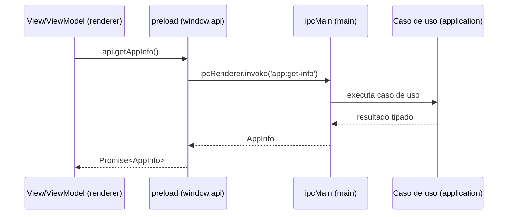

# Contrato IPC (main ↔ renderer)

O renderer não acessa Node, filesystem nem SQLite. Tudo passa por canais IPC tipados,
definidos em `src/shared/ipc.ts` e expostos no renderer como `window.api`.

## Fluxo

## Regras

- Cada canal tem um nome em `IpcChannel` e um método correspondente em `RendererApi`.
- O payload é validado na borda do main antes de chegar ao caso de uso.
- Erros são serializados como resultado tipado, nunca como exceção crua cruzando o IPC.
- Um `correlationId` acompanha a chamada para rastreio nos logs.

## Resultado tipado e erros

Canais que podem falhar retornam `IpcResult<T>` = `{ ok: true, data }` ou
`{ ok: false, error }`. O helper `runIpc` embrulha o handler: um erro é registrado com
`reportError` e vira `{ ok: false, error }` — nunca cruza o IPC como exceção crua.

## Composition root

No `bootstrap` do processo main, `createSchedulingContainer(db, { logger })` monta o grafo
(banco SQLite, repositórios, escalonador, regras, observabilidade, caso de uso) e entrega o
`GenerateWeeklySchedule`. `registerScheduleHandlers` liga o canal ao caso de uso. O DTO é
produzido por `toScheduleDto` na borda do main; o domínio nunca vaza para o renderer.

## Estado atual

| Canal               | Método da API          | Retorno                     |
| ------------------- | ---------------------- | --------------------------- |
| `app:get-info`      | `getAppInfo()`         | `AppInfo`                   |
| `schedule:generate` | `generateSchedule()`   | `IpcResult<ScheduleDto>`    |

Novos casos de uso adicionam uma entrada em `IpcChannel`, um método em `RendererApi`,
um handler no main e o adaptador de porta correspondente, nesta ordem.
