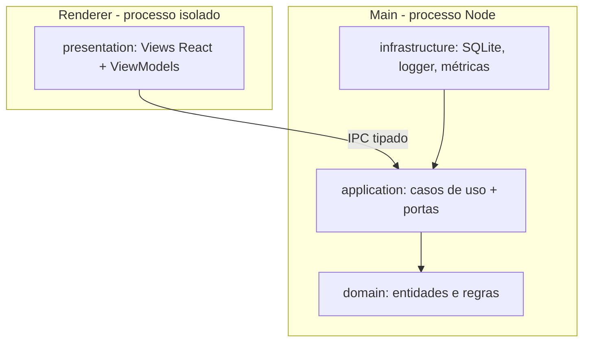

# Visão de arquitetura

O sistema segue **Clean Architecture**. As regras de negócio vivem no centro e não
conhecem framework, banco nem UI. As dependências apontam sempre para dentro.

## Processos do Electron

- **main**: processo Node. É o *composition root*: instancia os adaptadores de
  infraestrutura e injeta nos casos de uso. Hospeda `domain`, `application` e `infrastructure`.
- **preload**: expõe no renderer um `window.api` tipado, via `contextBridge`. Nenhum acesso
  direto a Node ou ao filesystem chega ao renderer.
- **renderer**: React + MVVM. Só fala com o backend pelo contrato IPC em `src/shared`.

## Segurança

- `contextIsolation: true`, `sandbox: true`, `nodeIntegration: false`.
- CSP restritiva no `index.html`.
- Todo payload de IPC é validado na borda.

## Observabilidade

- Logs estruturados (pino) com `correlationId` propagado do renderer ao main.
- Porta `Metrics` para duração do escalonador, backtracks e tempo de IPC/SQLite.
- Eventos de domínio persistidos para auditoria.

Detalhes das camadas em [`layers.md`](./layers.md) e do IPC em [`ipc.md`](./ipc.md).
